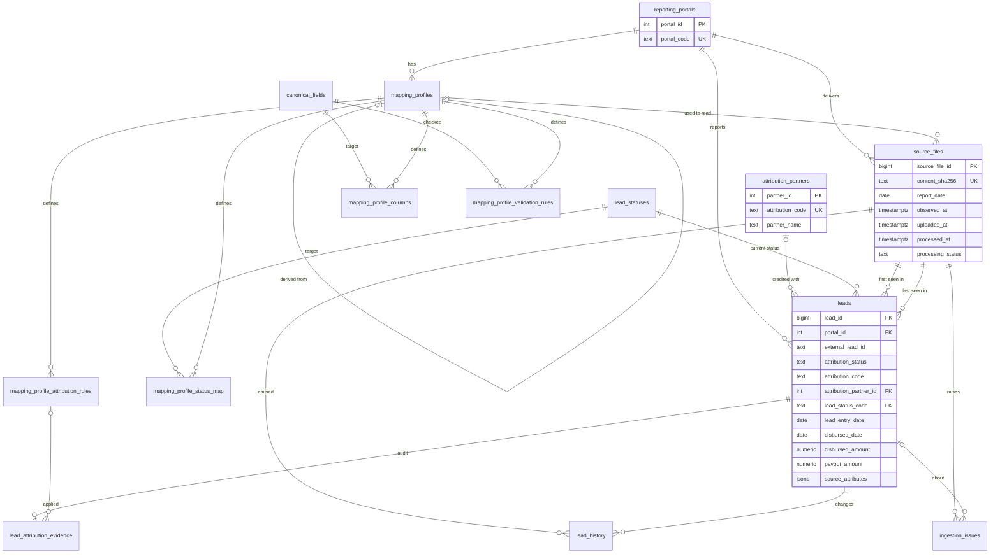

# MIS Lead Database — Schema Design v1 (for review)

> **Revision v1.1 (supersedes v1 where they differ).** (1) `report_type` is now a lookup (`report_types` + `report_type_import_modes`), not a CHECK. (2) `leads` identity is `(portal_id, id_namespace, external_lead_id)`; profiles carry `identity_namespace`; a `BEFORE INSERT OR UPDATE` trigger (`leads_merge_guard`) now enforces preserve-valid-values and stale-update protection in the database, so the E.2 upsert is simply `SET col = EXCLUDED.col`; `last_observed_at` added. (3) Migration validated on a clean PostgreSQL 16 database. Section E.2's hand-written CASE upsert is superseded by the trigger. Per your note, `leads_20260930_20261030.csv` is KreditBuddha.

**Status:** proposal, awaiting approval. No n8n workflow, importer, API or UI has been built.
**Basis:** all 9 files in `C:\code\mis_sheet_form\mis_sheets` were opened and profiled (not just the two named samples). The DDL in section C was loaded into PostgreSQL 16 and smoke-tested (constraints, frozen profiles, stale-update protection, enrichment upserts, the example queries in section F).

---

## A. Findings from the actual sample files

### A.1 File inventory

Counts exclude the header row. "Footer" = a trailing totals row that is not a lead.

| # | File | Format / size | Rows | Cols | Portal (how known) | Report type (assessment) |
|---|---|---|---|---|---|---|
| 1 | `CREDME_CLICKPE_ALL_LEADS_20261019_200107.csv` | CSV, 200 KB | 943 leads + 1 footer | 21 | CredMe (**confirmed**: filename) | Lead export, one entry-date cohort (all `Lead Entry Date` = 2026-10-19 = filename date) |
| 2 | `kreditbuddha_CLICKPE_leads_20261019_211948.csv` | CSV, 196 KB | 949 + 1 footer | 21 | KreditBuddha (**confirmed**: filename) | Same layout and cohort pattern as #1 |
| 3 | `brightloans_leads_20261019-fed78a20.csv.txt` | CSV in `.txt`, 16 KB | 80 + 1 footer | 21 | BrightLoans (**confirmed**: filename) | Same layout as #1; 0 disbursed |
| 4 | `salarymantra_CLICKPE_leads_20261019-bdedde32.csv.txt` | CSV in `.txt`, 343 KB | 1,589 + 1 footer | 21 | SalaryMantra (**confirmed**: filename) | Same layout as #1 |
| 5 | `digicredit_leads_20261019_20261019-b7e04cee.csv.txt` | CSV in `.txt`, 5 KB | 23, no footer | 18 | DigiCredit (**confirmed**: filename) | Lead export for a date range (from = to = 19 Oct) |
| 6 | `leads_20260930_20261030.csv` | CSV, 808 KB | 3,458, no footer | 18 | **Not in filename.** Assumed DigiCredit: identical 18 headers, and all 23 IDs of file #5 are present with identical values | Lead export, range 30 Sep–30 Oct in filename; actual entry dates 30 Sep–19 Oct |
| 7 | `creditsea_disbursed_cases_2026-10-19-2cab89d5.csv.txt` | CSV in `.txt`, 3 KB | 29, no footer | 7 | CreditSea (**confirmed**: filename) | **Disbursed-cases-only** report (partial by definition) |
| 8 | `Marketing Report_2026-10-19.xlsx` | XLSX, 17 KB, 1 sheet `Sheet 1`, A1:AJ13 | 12 | 36 | **Unknown** (filename has no portal). Its 12 `leadId`s are *not* among the 3,458 IDs in file #6 | Lead export from an internal-platform-style schema (UUIDs, `ppc_campaign`, document-status flags); nothing disbursed |
| 9 | `Marketing_Report_2026-10-20_00-16-15_47d6c1f3.xlsx` | XLSX, 6 KB, 1 sheet, A1:A1 | **0 — empty** | none | Unknown | **Empty.** One sheet, cell A1 blank, no header, no rows. No headers or mapping can be inferred |

All text files are plain ASCII, no BOM, LF line endings. Files 3, 4, 5, 7 and 9 carry an 8-hex-digit suffix in the name (e.g. `-fed78a20`) that is not a timestamp; it differs per download, so **filename cannot be used for duplicate detection — a content checksum is required.**

### A.2 Layout families (candidate reusable mapping profiles)

Headers match exactly within a family; business meaning was checked with values, not just names.

**Family `std21`** (files 1–4): `Lead ID, Partner Name, Lead Source, UTM Source, UTM Medium, UTM Campaign, UTM Term, Lead Status, Doable, Disbursment Date, Disbursment Amount, Pricing Model, Pricing Type, Pricing, Payout, Rejection Reason, State, City, Pincode, Date Of Birth, Lead Entry Date`
(Note the source spelling "Disbursment".)

**Family `dc18`** (files 5–6): `Lead ID, Date, Name, Employment Type, Loan Amt, Monthly Income, CIBIL, Salary Mode, City, State, Status, Remark, UTM Source, Medium, Campaign, Approved Amt, Disbursed Amt, Disbursement Date`

**Family `cs7`** (file 7): `User Creation Date, Application Number, Phone Number, Net Disbursed Amount (INR), Disbursal Date, Medium, Campaign`

**Family `mkt36`** (file 8): `customerId, leadId, purpose, loanAmount, monthlyIncome, salary, city, state, pincode, status, utm_source, lead_source, ppc_campaign, gclid, clid, third_party_id, ppc_source, created_at, updated_at, medium, aadhar_Details, pan_Details, facematch_Details, bankstatement, approvalAmount, breApproveAmount, remarks, disbursalAmount, disbursalDate, pancard, SalaryMode, AgentName, cbs_risk_grade_v1, e_sign, emandate, reference`

Same headers ≠ same attribution: the four `std21` files share a layout but not an attribution column (CredMe uses `UTM Medium`; the other three use `UTM Campaign`). So each portal gets **its own profile cloned from the family** (`derived_from_profile_id`), rather than one shared profile.

### A.3 Per-file detail

**`std21` files (1–4)**

| Aspect | Observed |
|---|---|
| Candidate lead ID | `Lead ID`: unique, non-blank in every data row of every file (0 duplicates). All-digit: CredMe 6-digit (442573–448123), KreditBuddha 7-digit (1576100–1584997), BrightLoans 7-digit (5266078–5276843), SalaryMantra 6-digit (131679–137386). Ranges are disjoint today, but that is coincidence — identity must include the portal |
| Footer | Last row: blank `Lead ID`, text in four columns, e.g. `Total Disbursed Count : 3` (Lead Status), `Total Doable Count : 53` (Doable), `Total Disbursed Amount : 99225` (Disbursment Amount), `Total Payout : 4961.25` (Payout). Must not be loaded as a lead. **Useful as a reconciliation check** (see below) |
| Constant columns | `Partner Name`=CLICKPE, `UTM Source`=CLICKPE, `UTM Term`=ORGANIC, `Pricing Model`=Disbursal. `Partner Name` is the *requesting* partner (ClickPe), **not** the attribution partner |
| Dates | `Lead Entry Date` = `YYYY-MM-DD`, single value per file = filename date. `Disbursment Date` = `YYYY-MM-DD`; always 2026-10-19 where present. `Date Of Birth` = `YYYY-MM-DD` (excluded) |
| Statuses | `SYSTEM-REJECT`, `REJECT`, `Reject` (mixed case, distinct strings), `LEAD-REGISTRATION`, `LEAD-PARTIAL`, `LEAD-HOLD`, `LEAD-INPROCESS`, `APPLICATION-NEW`, `APPLICATION-INPROCESS`, `APPLICATION-HOLD`, `APPLICATION-SEND-BACK`, `SANCTION`, `DISBURSE-PENDING`, `DISBURSED` |
| Rejection reason | Populated only on reject-type rows (every `SYSTEM-REJECT` and `Reject`, most `REJECT`; e.g. `ELIGIBILITY RULES NOT MET`); never on other statuses |
| Money | `Disbursment Amount`, `Payout`, `Pricing` are plain numbers (no currency symbol or thousands separators). `Payout` is `0` (not blank) when nothing is payable |
| **Disbursement amount trap** | `Disbursment Amount` and `Disbursment Date` are also populated on **non-disbursed** rows (DISBURSE-PENDING, APPLICATION-HOLD, SANCTION, APPLICATION-SEND-BACK). The footer total equals the sum over `DISBURSED` rows **only** in all four files (CredMe 99,225; KreditBuddha 139,797; SalaryMantra 300,321; BrightLoans 0). Summing the column naively would overstate disbursals by 92% (CredMe: 190,071 vs 99,225), 32% (KreditBuddha) and 47% (SalaryMantra) |
| Payout vs pricing | CredMe & SalaryMantra: `Pricing Type`=Percentage, 5.00; payout = 5% of disbursed amount, only on DISBURSED rows. KreditBuddha: `Flat` 5.00; payout 5.00 per DISBURSED row (footer 40 = 8×5). BrightLoans: `Flat` 800.00, no disbursals yet. Payout is 0 on non-DISBURSED rows |
| `Doable` | Yes/No. Every disbursed/pending/hold row is `Yes`; all SYSTEM-REJECT rows are `No` |
| Attribution | See A.4 |

**`dc18` files (5–6)**

| Aspect | Observed |
|---|---|
| Candidate lead ID | `Lead ID` = UUID, unique in each file (3,458 / 3,458; 23 / 23) |
| Footer | None |
| Dates | `Date` and `Disbursement Date` use `D Mon YYYY` with unpadded day (`6 Oct 2026`). `Date` is the lead entry date (file 5: all `19 Oct 2026`). In file 6, 150 of 211 disbursements are same-day and 61 are *after* entry — so unlike `std21`, this export does carry later disbursements |
| Statuses | `Rejected` 2,311, `Fresh Lead` 749, `Disbursed` 197, `Approved` 136, `Auto Withdrawal` 51, `Closed` 13, `Auto Disbursal` 1 |
| Money | `Loan Amt`, `Monthly Income`, `Approved Amt`, `Disbursed Amt` plain integers. `Disbursed Amt` + `Disbursement Date` are present on exactly the 211 rows with status Disbursed/Closed/Auto Disbursal; `Approved Amt` on those plus Approved and Auto Withdrawal (398). No payout column |
| Quirks | `Salary Mode` is identical to `Employment Type` in 100% of rows (mislabelled duplicate). `State` has 104 distinct spellings but 61 after upper-casing (`Kerala`/`KERALA`, `Uttarpradesh `). `Name` blank in 876/3,458. `Remark` free text: diagnostic text (`Score 698 and Affordability 2000`) and, on 197 rows, payment references (`UTR NO: <12 digits>`) |
| Attribution | See A.4. Columns are `UTM Source`, `Medium`, `Campaign` (no "UTM " prefix on the latter two); `Medium` ∈ {referral, app} |
| Relationship | File 5 ⊂ file 6: all 23 IDs match, 0 differences in Status/Remark/amounts/Campaign. So the daily file and the range file are **the same report type with different windows** |

**`cs7` file (7) — disbursed only**

| Aspect | Observed |
|---|---|
| Identifier | `Application Number`: 7-char alphanumeric, unique (29/29). **Unconfirmed** whether this equals the `Lead ID` CreditSea would use in a full-lead export — no such export was provided |
| No status column | Every row is a disbursal; `Disbursal Date` = `19 Oct 2026` for all 29 (= report date) |
| Money | `Net Disbursed Amount (INR)`: integers; sum 362,149. "Net" suggests fees may already be deducted (semantics unconfirmed) |
| Dates | `User Creation Date` ranges 31 Jan–19 Oct 2026 (also uses `Sept`, e.g. `17 Sept 2026`). Likely account creation, **not** necessarily lead entry |
| `Phone Number` | Pattern is 6 non-digit characters + 4 digits (appears masked). Not a usable join key; excluded |
| Attribution | `Medium` and `Campaign` identical for 28/29 rows; 1 row has `Medium`=`KF_…` / `Campaign`=`APP`. All 28 parseable rows resolve to code `000` |

**`mkt36` files (8–9)**

| Aspect | Observed |
|---|---|
| File 8 | 12 rows, all created 2026-10-19 (10:40–19:13). `leadId` UUID unique; `customerId` is a second UUID (sensitive). Statuses `Rejected` 10, `Fresh_Lead` 2 (underscore — differs from `Fresh Lead` in `dc18`). All numbers stored as text. `approvalAmount`, `disbursalAmount` all 0; `disbursalDate` blank. Attribution in `ppc_campaign` with lowercase `clickpe` prefix (codes 27P, 12I, 3FG, 000×9). `state` has `Uttarpradesh ` with trailing space. Document columns (`aadhar_Details`, `pan_Details`, `facematch_Details`, `bankstatement`, `reference`) hold booleans here — but their presence means future exports could carry real data, so they are excluded by default. `created_at` has time of day with no time zone |
| File 9 | Empty — see inventory. Its embedded creation time (18:46:15, read as UTC = 00:16:15 IST) matches the `00-16-15` in the filename |

### A.4 Attribution observations

Code = first 3 characters of the identifier in the UTM value, after removing a known prefix. Evidence for the identifier shape: in 99%+ of values the first 15 characters after the prefix are `3 alphanumeric + 12 hex digits`, followed by an optional customer-name suffix (e.g. `…_SINDHU_SINDHUBABY_BABY`). **UTM suffixes embed customer names** (PII).

| File | UTM field holding the code | Prefix | Parsed (3 + 12 hex) | ORGANIC | Not parseable |
|---|---|---|---|---|---|
| CredMe | `UTM Medium` | none | 940 | 2 | 1 (`17K…` — chars 4–15 contain a non-hex letter) |
| KreditBuddha | `UTM Campaign` | `CLICKPE` | 938 | 2 | 9 (all begin `CLICKPEKAMSAL…`, a different convention; a naive "first 3 chars" would give the wrong code `KAM`) |
| BrightLoans | `UTM Campaign` | `CLICKPE` | 80 | 0 | 0 |
| SalaryMantra | `UTM Campaign` | `CLICKPE` | 1,589 | 0 | 0 |
| DigiCredit daily | `Campaign` | `basic_referral` | 23 | 0 | 0 |
| DigiCredit range | `Campaign` | `basic_referral` | 3,425 | 0 | 33 (`app`) |
| CreditSea | `Campaign` (= `Medium` in 28/29) | none | 28 | 0 | 1 (`APP`; Medium `KF_4207361`) |
| Marketing xlsx | `ppc_campaign` | `clickpe` (lower-case) | 12 | 0 | 0 |

Code distribution (all files): **`000` dominates** — CredMe 94%, KreditBuddha 96%, SalaryMantra 96%, DigiCredit range 93%, CreditSea 100% of parseable rows, BrightLoans 56% — then `27P` (second everywhere), then a long tail (`12I`, `3FG`, `15M`, `10W`, `3KM`, `15A`, `1F7`, `2IT`, `3K3`, `14J`, `3BN`, `14E`). Codes are mixed digit/letter, include leading zeros (`000`), and values appear in both upper and lower case (`…ebf0cbde…` vs `…EBF0CBDE…`), so normalize to upper case. Prefix case also varies (`CLICKPE` vs `clickpe`).

### A.5 Observed facts vs. assumptions

| Observed (verified in the data) | Assumed (needs confirmation — see section G) |
|---|---|
| Layout families and header identity (A.2) | `leads_20260930_20261030.csv` belongs to DigiCredit |
| Footer rows exist in `std21` only; footer totals reconcile with `DISBURSED` rows only | The `Marketing Report` files' portal |
| Filename timestamps are in **IST** (checked on the two files that carry one): `200107` ↔ file modified time 20:01:07 IST, `211948` ↔ 21:19:50 IST | `000` means ClickPe-direct / default (unknown) |
| Every `std21` file is a single entry-date cohort with entry date = filename date | Whether such daily files are complete for the day (CredMe file generated at 20:01 IST) |
| `dc18` range file contains disbursements dated after entry | `Application Number` (CreditSea) = CreditSea's lead ID |
| Filename date formats differ: `YYYYMMDD` (files 1–6), `YYYY-MM-DD` (files 7–9) | Currency = INR for all portals |

---

## B. Proposed entity relationship design

### B.1 Table responsibilities

| Table | Responsibility | Cardinality / key relationships |
|---|---|---|
| `reporting_portals` | Master of **where reports come from** (CredMe, KreditBuddha…) | 1 portal → many profiles, files, leads |
| `attribution_partners` | Master of **who generated a lead**, keyed by 3-char text code | 1 partner → many leads, across portals. Partner and portal are independent |
| `lead_statuses` | Normalized status vocabulary (rows, not an enum, so it grows without DDL) | 1 status → many leads |
| `canonical_fields` | Closed list of fields a mapping may target | Referenced by mapping rows |
| `mapping_profiles` | One approved, versioned reading recipe per portal + report type | 1 portal → many profiles; versions per `profile_key` |
| `mapping_profile_columns` | Source header → canonical field / extras / excluded; transform; sensitivity; LLM policy | many per profile |
| `mapping_profile_status_map` | Source status → normalized status | many per profile |
| `mapping_profile_attribution_rules` | Which UTM field, prefixes, validation regex, organic literals | 1+ per profile (priority-ordered fallbacks) |
| `mapping_profile_validation_rules` | Required/regex/range checks from a fixed allow-list | many per profile |
| `source_files` | Ledger of every file: names, checksum, dates, mapping version, status, counts, footer totals, errors | 1 file → 1 profile; 1 file → many leads touched |
| `leads` | **Single** canonical table, current state of each lead | unique `(portal_id, external_lead_id)`; FK to portal, status, partner, files |
| `lead_attribution_evidence` | Raw UTM values + rule/profile/file that produced the attribution (restricted) | 1:1 with leads |
| `lead_history` | Append-only record of status/amount changes, written by trigger | many per lead |
| `ingestion_issues` | Quarantine/log: missing IDs, in-file duplicates, conflicts, stale skips, footer mismatches | many per file |

### B.2 ER diagram



### B.3 How the central requirements map to the structure

* **Portal ≠ partner.** `leads.portal_id` (where it was reported) and `leads.attribution_partner_id` (who generated it) are independent foreign keys to different masters. A CredMe file naturally contains many partners.
* **Attribution is never forced.** `attribution_status` ∈ `resolved` (code matches a registered partner), `unregistered_code` (valid-shaped code, no partner row yet — code kept, partner NULL), `organic`, `unresolved` (could not parse confidently). A CHECK constraint ties status ↔ partner ↔ code, and a composite FK `(attribution_partner_id, attribution_code)` makes it impossible for the stored code and partner to disagree.
* **No per-portal tables.** A new portal = rows in `reporting_portals` + a new mapping profile. No DDL.
* **Sensitive data stays out of `leads`.** Names, DOB, phone, document and income/bureau data are excluded at mapping level; raw UTMs (which embed names) live in the restricted `lead_attribution_evidence`.

---

## C. Schema definition (PostgreSQL DDL)

Single file, `schema_v1.sql`, also delivered separately. Runs in one transaction; tested on PostgreSQL 16 (uses only features available in 14+).

```sql
-- =====================================================================
-- MIS lead-ingestion schema  v1.1  (PROPOSED - pending review/approval)
-- v1.1: (1) report types are a lookup table; (2) lead identity has an id_namespace and the DB
--       itself enforces merge/stale-update rules on leads; (3) migration validated on a clean DB.
-- Target: PostgreSQL 14+ (tested on 16).  Single schema: mis
-- Scope : data model only. No importer / workflow / API code.
-- =====================================================================
BEGIN;

CREATE SCHEMA IF NOT EXISTS mis;
SET LOCAL search_path = mis, public;

-- ---------------------------------------------------------------------
-- 0. Shared helpers
-- ---------------------------------------------------------------------
CREATE FUNCTION set_updated_at() RETURNS trigger LANGUAGE plpgsql AS $$
BEGIN
  NEW.updated_at := now();
  RETURN NEW;
END $$;

-- ---------------------------------------------------------------------
-- 1. Reporting portals  (WHERE a report was downloaded from)
-- ---------------------------------------------------------------------
CREATE TABLE reporting_portals (
  portal_id     integer GENERATED ALWAYS AS IDENTITY PRIMARY KEY,
  portal_code   text        NOT NULL UNIQUE
                CHECK (portal_code ~ '^[a-z0-9_]+$'),          -- e.g. credme, kreditbuddha
  display_name  text        NOT NULL,
  website_url   text,
  is_active     boolean     NOT NULL DEFAULT true,
  notes         text,
  created_at    timestamptz NOT NULL DEFAULT now(),
  updated_at    timestamptz NOT NULL DEFAULT now()
);
CREATE TRIGGER trg_reporting_portals_updated BEFORE UPDATE ON reporting_portals
  FOR EACH ROW EXECUTE FUNCTION set_updated_at();

-- ---------------------------------------------------------------------
-- 2. Attribution partners  (WHO generated the lead; independent of portal)
-- ---------------------------------------------------------------------
CREATE TABLE attribution_partners (
  partner_id        integer GENERATED ALWAYS AS IDENTITY PRIMARY KEY,
  attribution_code  text        NOT NULL UNIQUE
                    CHECK (attribution_code ~ '^[0-9A-Z]{3}$'),  -- text: keeps leading zeros, upper-case only
  partner_name      text        NOT NULL,
  is_active         boolean     NOT NULL DEFAULT true,
  notes             text,
  created_at        timestamptz NOT NULL DEFAULT now(),
  updated_at        timestamptz NOT NULL DEFAULT now(),
  UNIQUE (partner_id, attribution_code)                          -- target of leads' composite FK
);
CREATE TRIGGER trg_attribution_partners_updated BEFORE UPDATE ON attribution_partners
  FOR EACH ROW EXECUTE FUNCTION set_updated_at();

-- ---------------------------------------------------------------------
-- 3. Reference: normalized lead statuses  (extend by INSERT, not by ALTER)
-- ---------------------------------------------------------------------
CREATE TABLE lead_statuses (
  status_code           text     PRIMARY KEY CHECK (status_code ~ '^[a-z_]+$'),
  display_name          text     NOT NULL,
  stage_order           smallint NOT NULL,       -- funnel position, for display/sorting only
  is_terminal           boolean  NOT NULL,
  implies_disbursement  boolean  NOT NULL DEFAULT false,  -- used by profile rule "only_if_status_implies_disbursement"
  description           text
);

-- ---------------------------------------------------------------------
-- 4. Reference: canonical fields a mapping may target
--    (adding a field = add a leads column + one row here; a new PORTAL needs no DDL)
-- ---------------------------------------------------------------------
CREATE TABLE canonical_fields (
  field_name   text PRIMARY KEY,
  data_type    text NOT NULL CHECK (data_type IN ('text','date','numeric','boolean','integer')),
  target       text NOT NULL CHECK (target IN ('identity','lead_column','attribution_evidence')),
  description  text
);

-- ---------------------------------------------------------------------
-- 5. Mapping registry
-- ---------------------------------------------------------------------
-- 5.0 Report types are DATA: add a type (and the import modes it may use) with INSERTs, no DDL.
CREATE TABLE report_types (
  report_type_code text PRIMARY KEY CHECK (report_type_code ~ '^[a-z0-9_]+$'),
  display_name     text    NOT NULL,
  is_partial       boolean NOT NULL DEFAULT false,   -- true: lists only some leads/facts; absence carries no meaning
  description      text
);
CREATE TABLE report_type_import_modes (
  report_type_code text NOT NULL REFERENCES report_types(report_type_code) ON UPDATE CASCADE,
  import_mode      text NOT NULL CHECK (import_mode IN ('snapshot','incremental','enrichment')),
  PRIMARY KEY (report_type_code, import_mode)
);
INSERT INTO report_types (report_type_code, display_name, is_partial, description) VALUES
 ('lead_export',     'Lead export',     false, 'Leads with status; may include disbursement columns'),
 ('disbursed_cases', 'Disbursed cases', true,  'Only disbursed cases; names just the leads it lists');
INSERT INTO report_type_import_modes (report_type_code, import_mode) VALUES
 ('lead_export','snapshot'), ('lead_export','incremental'), ('disbursed_cases','enrichment');

CREATE TABLE mapping_profiles (
  profile_id            integer GENERATED ALWAYS AS IDENTITY PRIMARY KEY,
  portal_id             integer NOT NULL REFERENCES reporting_portals(portal_id),
  profile_key           text    NOT NULL CHECK (profile_key ~ '^[a-z0-9_]+$'),   -- stable logical name
  version               integer NOT NULL CHECK (version > 0),
  report_type           text    NOT NULL REFERENCES report_types(report_type_code) ON UPDATE CASCADE,
  import_mode           text    NOT NULL,   -- validity per report type enforced by the composite FK below
  identity_namespace    text    NOT NULL DEFAULT 'lead_id' CHECK (identity_namespace ~ '^[a-z0-9_]+$'),
                        -- which identifier the profile's identity column carries ('lead_id', 'application_number', ...)
  layout_family         text,                                   -- informational label grouping compatible layouts
  derived_from_profile_id integer REFERENCES mapping_profiles(profile_id),
  -- how to recognise & read the file
  file_format           text    NOT NULL CHECK (file_format IN ('csv','xlsx')),
  sheet_name            text,
  header_row            smallint NOT NULL DEFAULT 1 CHECK (header_row >= 1),
  header_signature      text    NOT NULL CHECK (header_signature ~ '^[0-9a-f]{64}$'),
                        -- sha256 of the normalized (trimmed, lower-cased, sorted) header set
  filename_regex        text    NOT NULL,                       -- named groups: report_date [, report_time, period_start, period_end]
  report_date_format    text    NOT NULL CHECK (report_date_format IN ('YYYYMMDD','YYYY-MM-DD')),
  footer_row_regex      text,                                   -- row with blank identity whose any cell matches => footer, not a lead
  -- behaviour
  on_unknown_lead       text    NOT NULL DEFAULT 'create'
                        CHECK (on_unknown_lead IN ('create','quarantine','skip')),
  implied_status_code   text    REFERENCES lead_statuses(status_code),  -- e.g. 'disbursed' for disbursed-only reports
  -- lifecycle
  status                text    NOT NULL DEFAULT 'draft'
                        CHECK (status IN ('draft','proposed','approved','active','retired')),
  proposed_by           text    NOT NULL DEFAULT 'human' CHECK (proposed_by IN ('human','ai')),
  approved_by           text,
  approved_at           timestamptz,
  activated_at          timestamptz,
  retired_at            timestamptz,
  notes                 text,
  created_at            timestamptz NOT NULL DEFAULT now(),
  updated_at            timestamptz NOT NULL DEFAULT now(),
  UNIQUE (portal_id, profile_key, version),
  CHECK (status NOT IN ('approved','active','retired') OR (approved_by IS NOT NULL AND approved_at IS NOT NULL)),
  FOREIGN KEY (report_type, import_mode) REFERENCES report_type_import_modes (report_type_code, import_mode) ON UPDATE CASCADE
);
-- at most one active version per logical profile, and header-fingerprint lookup is unambiguous
CREATE UNIQUE INDEX uq_profile_one_active ON mapping_profiles (portal_id, profile_key) WHERE status = 'active';
CREATE UNIQUE INDEX uq_profile_active_signature ON mapping_profiles (portal_id, header_signature) WHERE status = 'active';
CREATE TRIGGER trg_mapping_profiles_updated BEFORE UPDATE ON mapping_profiles
  FOR EACH ROW EXECUTE FUNCTION set_updated_at();

-- Approved/active/retired profiles are frozen (only lifecycle columns may change).
CREATE FUNCTION guard_profile_frozen() RETURNS trigger LANGUAGE plpgsql AS $$
BEGIN
  IF OLD.status IN ('approved','active','retired')
     AND (to_jsonb(NEW) - ARRAY['status','activated_at','retired_at','approved_by','approved_at','notes','updated_at'])
         IS DISTINCT FROM
         (to_jsonb(OLD) - ARRAY['status','activated_at','retired_at','approved_by','approved_at','notes','updated_at'])
  THEN
    RAISE EXCEPTION 'mapping profile % is % and cannot be edited; create a new version', OLD.profile_id, OLD.status;
  END IF;
  RETURN NEW;
END $$;
CREATE TRIGGER trg_mapping_profiles_frozen BEFORE UPDATE ON mapping_profiles
  FOR EACH ROW EXECUTE FUNCTION guard_profile_frozen();

-- 5a. Source column -> canonical field / extras / excluded
CREATE TABLE mapping_profile_columns (
  column_map_id   integer GENERATED ALWAYS AS IDENTITY PRIMARY KEY,
  profile_id      integer NOT NULL REFERENCES mapping_profiles(profile_id) ON DELETE CASCADE,
  source_header   text    NOT NULL,
  header_key      text    GENERATED ALWAYS AS (lower(regexp_replace(btrim(source_header), '\s+', ' ', 'g'))) STORED,
  role            text    NOT NULL CHECK (role IN ('canonical','extra','exclude')),
  canonical_field text    REFERENCES canonical_fields(field_name),
  extra_key       text    CHECK (extra_key ~ '^[a-z0-9_]+$'),           -- key inside leads.source_attributes
  alias_priority  smallint NOT NULL DEFAULT 1,                          -- several headers -> one field: lowest priority number wins if non-blank
  transform       text    NOT NULL DEFAULT 'text'
                  CHECK (transform IN ('text','upper','number','date','yes_no_boolean','redact_digit_runs')),   -- closed allow-list, no code
  date_format     text    CHECK (date_format IN ('YYYY-MM-DD','DD Mon YYYY','YYYY-MM-DD HH24:MI:SS')),
  only_if_status_implies_disbursement boolean NOT NULL DEFAULT false,   -- value counts only on rows whose normalized status implies disbursement; otherwise parked in extra_key
  sensitivity     text    NOT NULL DEFAULT 'none'
                  CHECK (sensitivity IN ('none','contact','personal','identity_document','financial','credential','free_text')),
  llm_sample_policy text  NOT NULL DEFAULT 'none' CHECK (llm_sample_policy IN ('none','redacted','allowed')),
  exclusion_reason text,
  UNIQUE (profile_id, header_key),
  CHECK ((role = 'canonical') = (canonical_field IS NOT NULL)),
  CHECK (role <> 'extra' OR extra_key IS NOT NULL),
  CHECK (role <> 'exclude' OR exclusion_reason IS NOT NULL),
  CHECK ((transform = 'date') = (date_format IS NOT NULL)),
  CHECK (NOT only_if_status_implies_disbursement OR (role = 'canonical' AND extra_key IS NOT NULL)),
  CHECK (sensitivity = 'none' OR llm_sample_policy <> 'allowed')
);
CREATE INDEX ix_profile_columns_profile ON mapping_profile_columns (profile_id);   -- cascade/lookup (unique index leads with profile_id too; kept explicit for clarity)

-- 5b. Source status -> normalized status
CREATE TABLE mapping_profile_status_map (
  status_map_id     integer GENERATED ALWAYS AS IDENTITY PRIMARY KEY,
  profile_id        integer NOT NULL REFERENCES mapping_profiles(profile_id) ON DELETE CASCADE,
  source_status     text    NOT NULL,
  source_status_key text    GENERATED ALWAYS AS (lower(btrim(source_status))) STORED,
  status_code       text    NOT NULL REFERENCES lead_statuses(status_code),
  UNIQUE (profile_id, source_status_key)
);

-- 5c. Attribution extraction rules (per profile, ordered fallbacks)
CREATE TABLE mapping_profile_attribution_rules (
  rule_id          integer GENERATED ALWAYS AS IDENTITY PRIMARY KEY,
  profile_id       integer NOT NULL REFERENCES mapping_profiles(profile_id) ON DELETE CASCADE,
  priority         smallint NOT NULL DEFAULT 1,
  source_field     text    NOT NULL CHECK (source_field IN ('utm_source','utm_medium','utm_campaign','utm_term')),
  strip_prefixes   text[]  NOT NULL DEFAULT '{}',        -- case-insensitive literal prefixes removed before matching, e.g. {CLICKPE}
  identifier_regex text    NOT NULL DEFAULT '^([0-9A-Z]{3})[0-9A-F]{12}',
                   -- applied to UPPER(value minus prefix); group 1 = the 3-char code. Non-match => unresolved (never guessed)
  organic_values   text[]  NOT NULL DEFAULT '{}',        -- exact, case-insensitive values meaning "no partner", e.g. {ORGANIC}
  notes            text,
  UNIQUE (profile_id, priority),
  CHECK (identifier_regex LIKE '%(%)%')                  -- must contain a capture group
);

-- 5d. Validation rules (closed allow-list of rule types)
CREATE TABLE mapping_profile_validation_rules (
  rule_id          integer GENERATED ALWAYS AS IDENTITY PRIMARY KEY,
  profile_id       integer NOT NULL REFERENCES mapping_profiles(profile_id) ON DELETE CASCADE,
  canonical_field  text    NOT NULL REFERENCES canonical_fields(field_name),
  rule_type        text    NOT NULL CHECK (rule_type IN ('required','regex','min_value','max_value','allowed_values','not_after_report_date')),
  rule_param       jsonb   NOT NULL DEFAULT '{}',
  on_fail          text    NOT NULL DEFAULT 'quarantine_row' CHECK (on_fail IN ('quarantine_row','warn')),
  UNIQUE (profile_id, canonical_field, rule_type),
  CHECK (jsonb_typeof(rule_param) = 'object')
);

-- Frozen-profile guard for all four child tables
CREATE FUNCTION guard_profile_children_frozen() RETURNS trigger LANGUAGE plpgsql AS $$
DECLARE v_pid integer; v_status text;
BEGIN
  IF TG_OP = 'DELETE' THEN v_pid := OLD.profile_id; ELSE v_pid := NEW.profile_id; END IF;
  SELECT status INTO v_status FROM mapping_profiles WHERE profile_id = v_pid;
  IF FOUND AND v_status IN ('approved','active','retired') THEN
    RAISE EXCEPTION 'profile % is % ; its mapping rows are frozen. Create a new version.', v_pid, v_status;
  END IF;
  RETURN COALESCE(NEW, OLD);
END $$;
CREATE TRIGGER trg_cols_frozen   BEFORE INSERT OR UPDATE OR DELETE ON mapping_profile_columns           FOR EACH ROW EXECUTE FUNCTION guard_profile_children_frozen();
CREATE TRIGGER trg_status_frozen BEFORE INSERT OR UPDATE OR DELETE ON mapping_profile_status_map        FOR EACH ROW EXECUTE FUNCTION guard_profile_children_frozen();
CREATE TRIGGER trg_attr_frozen   BEFORE INSERT OR UPDATE OR DELETE ON mapping_profile_attribution_rules FOR EACH ROW EXECUTE FUNCTION guard_profile_children_frozen();
CREATE TRIGGER trg_valid_frozen  BEFORE INSERT OR UPDATE OR DELETE ON mapping_profile_validation_rules   FOR EACH ROW EXECUTE FUNCTION guard_profile_children_frozen();

-- ---------------------------------------------------------------------
-- 6. Source files  (one row per distinct file content; ingestion ledger)
-- ---------------------------------------------------------------------
CREATE TABLE source_files (
  source_file_id       bigint GENERATED ALWAYS AS IDENTITY PRIMARY KEY,
  portal_id            integer REFERENCES reporting_portals(portal_id),     -- NULL until portal is determined
  profile_id           integer REFERENCES mapping_profiles(profile_id),     -- mapping version used (NULL until matched)
  original_filename    text    NOT NULL,
  drive_file_id        text,
  content_sha256       text    NOT NULL UNIQUE CHECK (content_sha256 ~ '^[0-9a-f]{64}$'),   -- exact-duplicate guard
  size_bytes           bigint  CHECK (size_bytes >= 0),
  report_date          date,                       -- from filename; NOT lead_entry_date / disbursed_date
  period_start         date,                       -- only for range-style filenames
  period_end           date,
  observed_at          timestamptz,                -- freshness stamp: filename timestamp if present, else report_date at 00:00 (tz = business decision)
  uploaded_at          timestamptz,                -- when file reached Google Drive
  discovered_at        timestamptz NOT NULL DEFAULT now(),
  processing_started_at timestamptz,
  processed_at         timestamptz,                -- set only on success
  processing_status    text    NOT NULL DEFAULT 'discovered'
                       CHECK (processing_status IN ('discovered','needs_mapping','ready','processing','processed','failed','empty','rejected')),
  attempt_count        integer NOT NULL DEFAULT 0 CHECK (attempt_count >= 0),
  rows_total           integer CHECK (rows_total >= 0),
  rows_data            integer CHECK (rows_data >= 0),
  rows_footer          integer CHECK (rows_footer >= 0),
  rows_inserted        integer CHECK (rows_inserted >= 0),
  rows_updated         integer CHECK (rows_updated >= 0),
  rows_unchanged       integer CHECK (rows_unchanged >= 0),
  rows_stale_skipped   integer CHECK (rows_stale_skipped >= 0),
  rows_quarantined     integer CHECK (rows_quarantined >= 0),
  footer_totals        jsonb,                      -- parsed footer figures, to reconcile against loaded rows
  error_message        text,
  created_at           timestamptz NOT NULL DEFAULT now(),
  updated_at           timestamptz NOT NULL DEFAULT now(),
  CHECK (period_end IS NULL OR period_start IS NULL OR period_end >= period_start),
  CHECK (footer_totals IS NULL OR jsonb_typeof(footer_totals) = 'object'),
  CHECK (processing_status <> 'processed'
         OR (processed_at IS NOT NULL AND portal_id IS NOT NULL AND profile_id IS NOT NULL
             AND report_date IS NOT NULL AND observed_at IS NOT NULL))
);
CREATE INDEX ix_source_files_portal_report ON source_files (portal_id, report_date);
CREATE INDEX ix_source_files_drive         ON source_files (drive_file_id) WHERE drive_file_id IS NOT NULL;
CREATE INDEX ix_source_files_open          ON source_files (processing_status) WHERE processing_status NOT IN ('processed','empty');
CREATE TRIGGER trg_source_files_updated BEFORE UPDATE ON source_files
  FOR EACH ROW EXECUTE FUNCTION set_updated_at();

-- ---------------------------------------------------------------------
-- 7. Canonical leads  (single table for every portal)
-- ---------------------------------------------------------------------
CREATE TABLE leads (
  lead_id              bigint GENERATED ALWAYS AS IDENTITY PRIMARY KEY,
  portal_id            integer NOT NULL REFERENCES reporting_portals(portal_id),
  id_namespace         text    NOT NULL DEFAULT 'lead_id' CHECK (id_namespace ~ '^[a-z0-9_]+$'),
  external_lead_id     text    NOT NULL CHECK (btrim(external_lead_id) <> '' AND external_lead_id = btrim(external_lead_id)),
  -- attribution (code kept even if the partner is not registered yet)
  attribution_status   text    NOT NULL DEFAULT 'unresolved'
                       CHECK (attribution_status IN ('resolved','unregistered_code','organic','unresolved')),
  attribution_code     text    CHECK (attribution_code ~ '^[0-9A-Z]{3}$'),
  attribution_partner_id integer,
  -- lifecycle
  lead_status_code     text    NOT NULL REFERENCES lead_statuses(status_code),
  lead_status_raw      text,
  status_reason        text,                     -- rejection reason / remark (digit runs redacted by transform)
  is_doable            boolean,
  -- dates (never interchangeable)
  lead_entry_date      date,
  disbursed_date       date,
  -- money (INR assumed; see open questions)
  requested_loan_amount numeric(14,2) CHECK (requested_loan_amount >= 0),
  approved_amount      numeric(14,2) CHECK (approved_amount >= 0),
  disbursed_amount     numeric(14,2) CHECK (disbursed_amount >= 0),
  payout_amount        numeric(14,2) CHECK (payout_amount >= 0),
  -- low-sensitivity descriptors
  lead_source          text,
  employment_type      text,
  state                text,
  city                 text,
  pincode              text CHECK (pincode ~ '^[0-9]{6}$'),
  source_attributes    jsonb   NOT NULL DEFAULT '{}' CHECK (jsonb_typeof(source_attributes) = 'object'),
  -- freshness guards (see upsert strategy) and provenance
  status_observed_at       timestamptz NOT NULL,   -- '-infinity' until a mapped status has been seen
  disbursement_observed_at timestamptz NOT NULL,   -- '-infinity' until disbursement data has been seen
  last_observed_at         timestamptz NOT NULL,   -- observed_at of the newest file that touched this lead
  first_seen_file_id   bigint  NOT NULL REFERENCES source_files(source_file_id),
  last_seen_file_id    bigint  NOT NULL REFERENCES source_files(source_file_id),
  created_at           timestamptz NOT NULL DEFAULT now(),
  updated_at           timestamptz NOT NULL DEFAULT now(),

  CONSTRAINT uq_leads_identity UNIQUE (portal_id, id_namespace, external_lead_id),
  CONSTRAINT fk_leads_partner_code FOREIGN KEY (attribution_partner_id, attribution_code)
             REFERENCES attribution_partners (partner_id, attribution_code),
  CONSTRAINT ck_leads_attribution CHECK (
       (attribution_status = 'resolved'          AND attribution_partner_id IS NOT NULL AND attribution_code IS NOT NULL)
    OR (attribution_status = 'unregistered_code' AND attribution_partner_id IS NULL     AND attribution_code IS NOT NULL)
    OR (attribution_status IN ('organic','unresolved') AND attribution_partner_id IS NULL AND attribution_code IS NULL))
);
-- partner leads by entry date (counts, monthly series, partner comparison)
CREATE INDEX ix_leads_partner_entry ON leads (attribution_partner_id, lead_entry_date);
-- partner disbursement totals by disbursement date; covering for index-only SUM/COUNT
CREATE INDEX ix_leads_partner_disb  ON leads (attribution_partner_id, disbursed_date)
  INCLUDE (portal_id, disbursed_amount) WHERE disbursed_amount IS NOT NULL;
-- date-range / portal dashboards without a partner filter
CREATE INDEX ix_leads_entry_portal  ON leads (lead_entry_date, portal_id);
CREATE TRIGGER trg_leads_updated BEFORE UPDATE ON leads
  FOR EACH ROW EXECUTE FUNCTION set_updated_at();

-- ---------------------------------------------------------------------
-- 7b. Merge guard: the DATABASE enforces "preserve valid values" and "no stale overwrite",
--     so the importer can do a plain  ON CONFLICT ... DO UPDATE SET col = EXCLUDED.col.
--   Importer contract: supply NULL for any field the report does not carry; supply
--   lead_status_code = 'unmapped' when the report carries no usable status; set
--   status_observed_at = disbursement_observed_at = last_observed_at = source_files.observed_at.
-- ---------------------------------------------------------------------
CREATE FUNCTION leads_merge_guard() RETURNS trigger LANGUAGE plpgsql AS $$
DECLARE v_has_disb boolean;
BEGIN
  IF TG_OP = 'INSERT' THEN
    -- A freshness stamp only means something once data of that group has arrived.
    IF NEW.lead_status_code = 'unmapped' THEN NEW.status_observed_at := '-infinity'; END IF;
    IF NEW.disbursed_amount IS NULL AND NEW.disbursed_date IS NULL AND NEW.payout_amount IS NULL THEN
      NEW.disbursement_observed_at := '-infinity';
    END IF;
    RETURN NEW;
  END IF;
  IF NEW.portal_id <> OLD.portal_id OR NEW.id_namespace <> OLD.id_namespace
     OR NEW.external_lead_id <> OLD.external_lead_id THEN
    RAISE EXCEPTION 'lead identity is immutable (lead_id %)', OLD.lead_id;
  END IF;
  NEW.first_seen_file_id := OLD.first_seen_file_id;

  -- Status group: ignored when stale or when the report carries no mapped status.
  IF NEW.lead_status_code = 'unmapped' OR NEW.status_observed_at < OLD.status_observed_at THEN
    NEW.lead_status_code := OLD.lead_status_code;  NEW.lead_status_raw := OLD.lead_status_raw;
    NEW.status_reason    := OLD.status_reason;     NEW.approved_amount := OLD.approved_amount;
    NEW.is_doable        := OLD.is_doable;         NEW.status_observed_at := OLD.status_observed_at;
  ELSE
    NEW.approved_amount := COALESCE(NEW.approved_amount, OLD.approved_amount);
    NEW.is_doable       := COALESCE(NEW.is_doable, OLD.is_doable);
    NEW.lead_status_raw := COALESCE(NEW.lead_status_raw, OLD.lead_status_raw);
    IF NEW.lead_status_code = OLD.lead_status_code THEN      -- reason only carries over if status is unchanged
      NEW.status_reason := COALESCE(NEW.status_reason, OLD.status_reason);
    END IF;
  END IF;

  -- Disbursement group: stale ignored; blanks never erase; stamp advances only when data arrived.
  IF NEW.disbursement_observed_at < OLD.disbursement_observed_at THEN
    NEW.disbursed_amount := OLD.disbursed_amount; NEW.disbursed_date := OLD.disbursed_date;
    NEW.payout_amount    := OLD.payout_amount;    NEW.disbursement_observed_at := OLD.disbursement_observed_at;
  ELSE
    v_has_disb := NEW.disbursed_amount IS NOT NULL OR NEW.disbursed_date IS NOT NULL OR NEW.payout_amount IS NOT NULL;
    NEW.disbursed_amount := COALESCE(NEW.disbursed_amount, OLD.disbursed_amount);
    NEW.disbursed_date   := COALESCE(NEW.disbursed_date,   OLD.disbursed_date);
    NEW.payout_amount    := COALESCE(NEW.payout_amount,    OLD.payout_amount);
    IF NOT v_has_disb THEN NEW.disbursement_observed_at := OLD.disbursement_observed_at; END IF;
  END IF;

  -- Attribution: set once. unresolved -> anything; unregistered_code -> resolved (same code). Else frozen.
  IF NOT (OLD.attribution_status = 'unresolved'
          OR (OLD.attribution_status = 'unregistered_code'
              AND NEW.attribution_code IS NOT DISTINCT FROM OLD.attribution_code
              AND NEW.attribution_status IN ('unregistered_code','resolved'))) THEN
    NEW.attribution_status := OLD.attribution_status; NEW.attribution_code := OLD.attribution_code;
    NEW.attribution_partner_id := OLD.attribution_partner_id;
  END IF;

  -- Descriptors and provenance: newer file wins when it has a value; an older file may only fill blanks.
  IF NEW.last_observed_at < OLD.last_observed_at THEN
    NEW.lead_source := COALESCE(OLD.lead_source, NEW.lead_source);
    NEW.employment_type := COALESCE(OLD.employment_type, NEW.employment_type);
    NEW.state := COALESCE(OLD.state, NEW.state);  NEW.city := COALESCE(OLD.city, NEW.city);
    NEW.pincode := COALESCE(OLD.pincode, NEW.pincode);
    NEW.requested_loan_amount := COALESCE(OLD.requested_loan_amount, NEW.requested_loan_amount);
    NEW.source_attributes := NEW.source_attributes || OLD.source_attributes;     -- existing keys win
    NEW.last_seen_file_id := OLD.last_seen_file_id;  NEW.last_observed_at := OLD.last_observed_at;
  ELSE
    NEW.lead_source := COALESCE(NEW.lead_source, OLD.lead_source);
    NEW.employment_type := COALESCE(NEW.employment_type, OLD.employment_type);
    NEW.state := COALESCE(NEW.state, OLD.state);  NEW.city := COALESCE(NEW.city, OLD.city);
    NEW.pincode := COALESCE(NEW.pincode, OLD.pincode);
    NEW.requested_loan_amount := COALESCE(NEW.requested_loan_amount, OLD.requested_loan_amount);
    NEW.source_attributes := OLD.source_attributes || NEW.source_attributes;     -- incoming keys win
  END IF;
  NEW.lead_entry_date := COALESCE(OLD.lead_entry_date, NEW.lead_entry_date);     -- entry date never moves
  RETURN NEW;
END $$;
CREATE TRIGGER trg_leads_merge_guard BEFORE INSERT OR UPDATE ON leads
  FOR EACH ROW EXECUTE FUNCTION leads_merge_guard();

-- 7a. Attribution evidence (raw UTMs; restricted - may embed customer names in suffixes)
CREATE TABLE lead_attribution_evidence (
  lead_id         bigint PRIMARY KEY REFERENCES leads(lead_id) ON DELETE CASCADE,
  source_file_id  bigint NOT NULL REFERENCES source_files(source_file_id),
  profile_id      integer NOT NULL REFERENCES mapping_profiles(profile_id),         -- mapping version used
  rule_id         integer REFERENCES mapping_profile_attribution_rules(rule_id),    -- NULL when no rule matched
  utm_source      text,
  utm_medium      text,
  utm_campaign    text,
  utm_term        text,
  created_at      timestamptz NOT NULL DEFAULT now()
);
-- (profile_id/source_file_id FK indexes intentionally omitted: parents are rarely deleted)

-- ---------------------------------------------------------------------
-- 8. Lead history: append-only, written by trigger only when tracked fields change
-- ---------------------------------------------------------------------
CREATE TABLE lead_history (
  history_id        bigint GENERATED ALWAYS AS IDENTITY PRIMARY KEY,
  lead_id           bigint  NOT NULL REFERENCES leads(lead_id) ON DELETE CASCADE,
  source_file_id    bigint  NOT NULL REFERENCES source_files(source_file_id),
  observed_at       timestamptz NOT NULL,
  lead_status_code  text    NOT NULL,
  lead_status_raw   text,
  approved_amount   numeric(14,2),
  disbursed_amount  numeric(14,2),
  disbursed_date    date,
  payout_amount     numeric(14,2),
  recorded_at       timestamptz NOT NULL DEFAULT now()
);
CREATE INDEX ix_lead_history_lead ON lead_history (lead_id, history_id DESC);

CREATE FUNCTION record_lead_history() RETURNS trigger LANGUAGE plpgsql AS $$
BEGIN
  IF TG_OP = 'INSERT'
     OR (NEW.lead_status_code, NEW.lead_status_raw, NEW.approved_amount, NEW.disbursed_amount, NEW.disbursed_date, NEW.payout_amount)
        IS DISTINCT FROM
        (OLD.lead_status_code, OLD.lead_status_raw, OLD.approved_amount, OLD.disbursed_amount, OLD.disbursed_date, OLD.payout_amount)
  THEN
    INSERT INTO lead_history (lead_id, source_file_id, observed_at, lead_status_code, lead_status_raw,
                              approved_amount, disbursed_amount, disbursed_date, payout_amount)
    VALUES (NEW.lead_id, NEW.last_seen_file_id, NEW.last_observed_at,
            NEW.lead_status_code, NEW.lead_status_raw,
            NEW.approved_amount, NEW.disbursed_amount, NEW.disbursed_date, NEW.payout_amount);
  END IF;
  RETURN NULL;
END $$;
CREATE TRIGGER trg_leads_history AFTER INSERT OR UPDATE ON leads
  FOR EACH ROW EXECUTE FUNCTION record_lead_history();

-- ---------------------------------------------------------------------
-- 9. Ingestion issues / quarantine  (rows that could not be safely applied)
--    details must hold ONLY non-sensitive fields (no names, phone, DOB, documents)
-- ---------------------------------------------------------------------
CREATE TABLE ingestion_issues (
  issue_id          bigint GENERATED ALWAYS AS IDENTITY PRIMARY KEY,
  source_file_id    bigint  NOT NULL REFERENCES source_files(source_file_id),
  row_number        integer,
  issue_type        text    NOT NULL CHECK (issue_type IN (
                      'missing_external_id','duplicate_in_file','validation_failed','unmapped_status',
                      'attribution_conflict','unknown_lead_skipped','stale_update_skipped','footer_mismatch',
                      'absent_from_snapshot','other')),
  severity          text    NOT NULL DEFAULT 'warning' CHECK (severity IN ('error','warning','info')),
  external_lead_id  text,
  lead_id           bigint  REFERENCES leads(lead_id) ON DELETE SET NULL,
  message           text,
  details           jsonb   NOT NULL DEFAULT '{}' CHECK (jsonb_typeof(details) = 'object'),
  is_resolved       boolean NOT NULL DEFAULT false,
  resolved_at       timestamptz,
  created_at        timestamptz NOT NULL DEFAULT now()
);
CREATE INDEX ix_issues_file ON ingestion_issues (source_file_id);
CREATE INDEX ix_issues_open ON ingestion_issues (issue_type) WHERE NOT is_resolved;

-- ---------------------------------------------------------------------
-- 10. Reference seed data (needed by FKs; proposed, subject to approval)
-- ---------------------------------------------------------------------
INSERT INTO lead_statuses (status_code, display_name, stage_order, is_terminal, implies_disbursement, description) VALUES
 ('registered',           'Registered',            10, false, false, 'Lead created / registered, no application yet'),
 ('partial',              'Partial application',   20, false, false, 'Application started but incomplete'),
 ('in_process',           'In process',            30, false, false, 'Application under processing'),
 ('on_hold',              'On hold / sent back',   35, false, false, 'Held or sent back for correction'),
 ('approved',             'Approved / sanctioned', 40, false, false, 'Approved or sanctioned, not yet disbursed'),
 ('disbursement_pending', 'Disbursement pending',  50, false, false, 'Disbursal initiated but not completed'),
 ('disbursed',            'Disbursed',             60, false, true,  'Loan disbursed'),
 ('closed',               'Closed',                70, true,  false, 'Closed after disbursal (meaning to be confirmed)'),
 ('withdrawn',            'Withdrawn',             80, true,  false, 'Withdrawn / auto-withdrawn'),
 ('rejected',             'Rejected',              90, true,  false, 'Rejected (system or manual)'),
 ('unmapped',             'Unmapped status',       99, false, false, 'Source status has no approved mapping - needs review');

INSERT INTO canonical_fields (field_name, data_type, target, description) VALUES
 ('external_lead_id',      'text',    'identity',             'Portal-assigned lead identifier (kept as text)'),
 ('lead_status_raw',       'text',    'lead_column',          'Status exactly as reported by the portal'),
 ('status_reason',         'text',    'lead_column',          'Rejection reason or remark'),
 ('is_doable',             'boolean', 'lead_column',          'Portal "Doable" eligibility flag'),
 ('lead_entry_date',       'date',    'lead_column',          'Date lead entered the portal system'),
 ('disbursed_date',        'date',    'lead_column',          'Date of disbursement'),
 ('requested_loan_amount', 'numeric', 'lead_column',          'Amount requested by customer'),
 ('approved_amount',       'numeric', 'lead_column',          'Approved / sanctioned amount'),
 ('disbursed_amount',      'numeric', 'lead_column',          'Amount actually disbursed'),
 ('payout_amount',         'numeric', 'lead_column',          'Payout reported by portal'),
 ('lead_source',           'text',    'lead_column',          'Portal lead-source / channel label'),
 ('employment_type',       'text',    'lead_column',          'Salaried / self-employed'),
 ('state',                 'text',    'lead_column',          'State'),
 ('city',                  'text',    'lead_column',          'City'),
 ('pincode',               'text',    'lead_column',          'Postal code (text)'),
 ('utm_source',            'text',    'attribution_evidence', 'Raw UTM source'),
 ('utm_medium',            'text',    'attribution_evidence', 'Raw UTM medium'),
 ('utm_campaign',          'text',    'attribution_evidence', 'Raw UTM campaign'),
 ('utm_term',              'text',    'attribution_evidence', 'Raw UTM term');

COMMIT;
```

---

## D. Data dictionary

Legend: **Req** = NOT NULL. All `created_at`/`updated_at` are `timestamptz NOT NULL DEFAULT now()`; `updated_at` is maintained by trigger.

### D.1 `reporting_portals`
| Column | Type | Req | Purpose / constraints |
|---|---|---|---|
| portal_id | integer identity PK | ✔ | Surrogate key |
| portal_code | text UNIQUE | ✔ | Stable slug `^[a-z0-9_]+$` (`credme`, `kreditbuddha`) |
| display_name | text | ✔ | UI label |
| website_url, notes | text | | Optional |
| is_active | boolean | ✔ | Default true |

### D.2 `attribution_partners`
| Column | Type | Req | Purpose / constraints |
|---|---|---|---|
| partner_id | integer identity PK | ✔ | Surrogate key used by UI filters |
| attribution_code | text UNIQUE | ✔ | Exactly 3 chars `^[0-9A-Z]{3}$` — text, upper-case, leading zeros kept |
| partner_name | text | ✔ | Display name |
| is_active, notes | boolean / text | | |
| (partner_id, attribution_code) | UNIQUE | | Target of leads' composite FK |

### D.3 `lead_statuses` (reference)
`status_code` text PK (`^[a-z_]+$`); `display_name`; `stage_order` smallint (display order only); `is_terminal` boolean; `implies_disbursement` boolean (drives column rule `only_if_status_implies_disbursement`); `description`. Seeded: registered, partial, in_process, on_hold, approved, disbursement_pending, disbursed, closed, withdrawn, rejected, unmapped. **Seed values are proposals** — the raw source status is always kept in `leads.lead_status_raw`.

### D.4 `canonical_fields` (reference)
`field_name` PK; `data_type` (text/date/numeric/boolean/integer); `target` (identity / lead_column / attribution_evidence); `description`. Limits what an AI-suggested mapping may point at.

### D.5 `mapping_profiles`
| Column | Type | Req | Purpose |
|---|---|---|---|
| profile_id | integer identity PK | ✔ | Mapping version id; stored on every ingested file |
| portal_id | FK → reporting_portals | ✔ | Profiles are per portal |
| profile_key, version | text, int | ✔ | Logical name + version; UNIQUE (portal_id, profile_key, version) |
| report_type | text | ✔ | `lead_export` or `disbursed_cases` (extend via CHECK migration) |
| import_mode | text | ✔ | `snapshot` / `incremental` / `enrichment`; `disbursed_cases` ⇒ `enrichment` (CHECK) |
| layout_family | text | | Informational grouping (`std21`, `dc18`…) |
| derived_from_profile_id | self FK | | Clone lineage |
| file_format, sheet_name, header_row | text, text, smallint | ✔/–/✔ | How to read the file |
| header_signature | text (sha-256 hex) | ✔ | Fingerprint of normalized header set → matches new files to a profile without an LLM |
| filename_regex, report_date_format | text | ✔ | Named groups `report_date` (+ optional `report_time`, `period_start`, `period_end`); `YYYYMMDD` or `YYYY-MM-DD` |
| footer_row_regex | text | | Rows with blank identity and any cell matching are footers |
| on_unknown_lead | text | ✔ | `create` / `quarantine` / `skip` for IDs not yet in `leads` (default create) |
| implied_status_code | FK → lead_statuses | | For disbursed-only reports (`disbursed`) |
| status | text | ✔ | draft → proposed → approved → active → retired |
| proposed_by, approved_by, approved_at, activated_at, retired_at | | | Approval trail. `approved/active/retired` require approver + time |

Integrity: one **active** version per `(portal_id, profile_key)` and one active profile per `(portal_id, header_signature)` (partial unique indexes). Once approved, the profile and all its child rows are frozen by trigger; changes require a new version.

### D.6 `mapping_profile_columns`
| Column | Type | Req | Purpose |
|---|---|---|---|
| column_map_id | identity PK | ✔ | |
| profile_id | FK (cascade) | ✔ | |
| source_header / header_key | text / generated | ✔ | Header as seen / normalized (lower-case, collapsed spaces). UNIQUE (profile_id, header_key) |
| role | text | ✔ | `canonical` (→ canonical_field), `extra` (→ `source_attributes[extra_key]`), `exclude` (never stored; `exclusion_reason` mandatory) |
| canonical_field | FK → canonical_fields | if role=canonical | |
| extra_key | text | if role=extra, or conditional rule | JSON key |
| alias_priority | smallint | ✔ | Several headers → one field: lowest number with a non-blank value wins |
| transform | text | ✔ | Closed allow-list: text, upper, number, date, yes_no_boolean, redact_digit_runs. **No code or expressions** |
| date_format | text | with transform=date | `YYYY-MM-DD`, `DD Mon YYYY` (lenient: unpadded day, `Sept`), `YYYY-MM-DD HH24:MI:SS` |
| only_if_status_implies_disbursement | boolean | ✔ | Value counts only if the row's normalized status implies disbursement; otherwise parked under `extra_key` (used for `std21` disbursement columns) |
| sensitivity | text | ✔ | none / contact / personal / identity_document / financial / credential / free_text |
| llm_sample_policy | text | ✔ | `none` (header only) / `redacted` / `allowed`; `allowed` is forbidden when sensitivity ≠ none |

### D.7 `mapping_profile_status_map`
`profile_id` FK; `source_status`; `source_status_key` (generated lower/trim); `status_code` FK → lead_statuses. UNIQUE (profile_id, source_status_key) — matching is case-insensitive, so `Reject`/`REJECT` need one row.

### D.8 `mapping_profile_attribution_rules`
| Column | Purpose |
|---|---|
| profile_id, priority | UNIQUE pair; lower priority number tried first (fallback sources) |
| source_field | `utm_source/medium/campaign/term` — the *canonical* UTM field, so header renames don't affect rules |
| strip_prefixes text[] | Case-insensitive literal prefixes removed first (`{CLICKPE}`, `{basic_referral}`) |
| identifier_regex | Applied to UPPER(value minus prefix); group 1 = the 3-char code. Default `^([0-9A-Z]{3})[0-9A-F]{12}`. No match ⇒ `unresolved`. Must contain a capture group |
| organic_values text[] | Exact values meaning "no partner" (`{ORGANIC}`) |

### D.9 `mapping_profile_validation_rules`
`profile_id`; `canonical_field`; `rule_type` ∈ required, regex, min_value, max_value, allowed_values, not_after_report_date; `rule_param` jsonb object; `on_fail` ∈ quarantine_row / warn. UNIQUE (profile_id, canonical_field, rule_type).

### D.10 `source_files`
| Column | Type | Req | Purpose |
|---|---|---|---|
| source_file_id | bigint identity PK | ✔ | |
| portal_id | FK | – | NULL until the portal is determined (e.g. file with no portal in its name) |
| profile_id | FK | – | **Mapping version used.** NULL until matched |
| original_filename | text | ✔ | |
| drive_file_id | text | – | Google Drive ID (non-unique: a Drive file can be re-uploaded with new content) |
| content_sha256 | text UNIQUE | ✔ | Exact-duplicate guard (64 hex) |
| size_bytes | bigint | – | |
| **report_date** | date | – | From filename. Not an entry or disbursement date |
| period_start / period_end | date | – | Range-style filenames only |
| observed_at | timestamptz | – | Freshness stamp for stale protection: filename timestamp (IST) if present, else report_date at 00:00 IST |
| **uploaded_at** | timestamptz | – | When the file reached Google Drive |
| discovered_at | timestamptz | ✔ | When the pipeline first saw it |
| processing_started_at / **processed_at** | timestamptz | – | `processed_at` only on success |
| processing_status | text | ✔ | discovered, needs_mapping, ready, processing, processed, failed, empty, rejected |
| attempt_count | int | ✔ | Retries |
| rows_total/data/footer/inserted/updated/unchanged/stale_skipped/quarantined | int | – | Per-file counters |
| footer_totals | jsonb | – | Parsed footer figures to reconcile with loaded rows |
| error_message | text | – | |

A `processed` file must have portal, profile, report_date, observed_at and processed_at (CHECK).

### D.11 `leads`
| Column | Type | Req | Purpose |
|---|---|---|---|
| lead_id | bigint identity PK | ✔ | Internal key |
| portal_id | FK | ✔ | Reporting portal |
| external_lead_id | text | ✔ | Portal's ID, untouched (no numeric cast; no leading/trailing spaces; non-blank). UNIQUE with portal_id |
| attribution_status | text | ✔ | resolved / unregistered_code / organic / unresolved (default unresolved) |
| attribution_code | text | – | 3-char upper-case code; NULL for organic/unresolved |
| attribution_partner_id | integer | – | Set only when status=resolved. Composite FK with code |
| lead_status_code | FK → lead_statuses | ✔ | Normalized status |
| lead_status_raw | text | – | Status as reported |
| status_reason | text | – | Rejection reason / remark (digit runs redacted) |
| is_doable | boolean | – | `Doable` flag (`std21` only) |
| **lead_entry_date** | date | – | Date lead entered the portal |
| **disbursed_date** | date | – | Date of disbursement |
| requested_loan_amount, approved_amount, disbursed_amount, payout_amount | numeric(14,2) ≥ 0 | – | NULL = unknown/not supplied (never 0 as a placeholder) |
| lead_source, employment_type, state, city | text | – | Descriptors |
| pincode | text | – | Six digits; text keeps leading zeros |
| source_attributes | jsonb object | ✔ | Non-sensitive unmapped fields (`pricing_model`, `pricing_type`, `pricing_value`, `unconfirmed_disbursement_amount`…) |
| status_observed_at | timestamptz | ✔ | Freshness of the status group (see E.2) |
| disbursement_observed_at | timestamptz | ✔ | Freshness of the disbursement group |
| first_seen_file_id / last_seen_file_id | FK → source_files | ✔ | Provenance |

### D.12 `lead_attribution_evidence` (restricted)
`lead_id` PK/FK (cascade); `source_file_id` FK; `profile_id` FK (**mapping version used**); `rule_id` FK (NULL if no rule matched); `utm_source/medium/campaign/term` raw as received (campaign/medium may carry customer names → restrict with grants).

### D.13 `lead_history`
`history_id` PK; `lead_id` FK; `source_file_id` FK (file that caused the change); `observed_at`; `lead_status_code`; `lead_status_raw`; `approved_amount`; `disbursed_amount`; `disbursed_date`; `payout_amount`; `recorded_at`. Written by trigger on insert and only when one of those six fields changes.

### D.14 `ingestion_issues`
`issue_id` PK; `source_file_id` FK; `row_number`; `issue_type` (missing_external_id, duplicate_in_file, validation_failed, unmapped_status, attribution_conflict, unknown_lead_skipped, stale_update_skipped, footer_mismatch, absent_from_snapshot, other); `severity`; `external_lead_id`; `lead_id` FK (SET NULL); `message`; `details` jsonb (**non-sensitive fields only**); `is_resolved`; `resolved_at`.

---

## E. Key implementation decisions

### E.1 Lead identity and deduplication

* **Identity = `(portal_id, external_lead_id)`**, enforced by `UNIQUE` in PostgreSQL (`uq_leads_identity`). Evidence: in all 8 non-empty files the ID is non-blank and unique within the file; formats differ by portal (6/7-digit numbers, UUIDs, 7-char alphanumerics), so the ID is stored as text and is meaningful only inside its portal. The same ID in two portals is two leads (tested).
* **Assumptions behind it** (to be confirmed, G.4–G.5): (a) a portal never reuses an ID for a different customer; (b) the ID in a portal's disbursed-only report equals the ID in its lead export — **not verifiable for CreditSea** with the files provided.
* **Missing ID** (not present in the samples apart from footer rows): the row is **quarantined** (`ingestion_issues.missing_external_id`), never inserted with a guessed key. No fallback match on phone/name is proposed: it would require retaining PII and risks merging different people. If a portal later needs one, add a keyed hash column then, with explicit approval.
* **Same lead twice in one file:** the importer must collapse or quarantine (`duplicate_in_file`) before upsert, because `INSERT … ON CONFLICT` cannot touch a row twice in one statement.
* **Exact duplicate upload:** `source_files.content_sha256` is UNIQUE; the second insert is a no-op and the existing row is reused.
* **Interrupted run / retry:** each file is applied in **one transaction**; `processed_at` and counters are written in the same transaction. A crash leaves no partial effect; a retry re-runs the same upsert, which is idempotent (E.2).
* **Person-level dedupe across portals is out of scope.** "Distinct leads" means distinct `(portal, lead id)`. One customer applying through two portals counts twice (G.10).

### E.2 Upsert and stale-update protection (illustrative SQL, tested)

Principle: **absence is not information.** A row missing from a report changes nothing — nothing is ever deleted or downgraded because it is absent. Only rows present in a report touch the table, and only for fields the report actually supplies.

Two freshness stamps on each lead make the rules per field-group instead of per row, so a disbursed-only report cannot be undone by an older lead export (and vice versa):

| Field group | Guard | Rule |
|---|---|---|
| Status group: `lead_status_*`, `status_reason`, `approved_amount` | `status_observed_at` | Take incoming only if incoming status is mapped (not `unmapped`) and `file.observed_at >= status_observed_at` |
| Disbursement group: `disbursed_amount`, `disbursed_date`, `payout_amount` | `disbursement_observed_at` | Take incoming only if it **has a value** and `file.observed_at >= disbursement_observed_at`. A blank never overwrites a value |
| Descriptors (`state`, `city`, `lead_entry_date`, `employment_type`, …) | none | Fill-if-empty (`COALESCE(existing, incoming)`) |
| Attribution | `attribution_status` | Only an `unresolved` lead can be filled in. A different code arriving later is **not applied**; it raises `attribution_conflict` |

```sql
INSERT INTO mis.leads AS l (portal_id, external_lead_id, lead_status_code, lead_status_raw,
        disbursed_amount, disbursed_date, state, status_observed_at, disbursement_observed_at,
        first_seen_file_id, last_seen_file_id /* … */)
SELECT portal_id, external_lead_id, lead_status_code, lead_status_raw,
       disbursed_amount, disbursed_date, state, observed_at, observed_at, file_id, file_id
FROM   staging_rows                       -- session temp table filled by the importer
ON CONFLICT (portal_id, external_lead_id) DO UPDATE SET
  lead_status_code = CASE WHEN EXCLUDED.status_observed_at >= l.status_observed_at
                           AND EXCLUDED.lead_status_code <> 'unmapped'
                          THEN EXCLUDED.lead_status_code ELSE l.lead_status_code END,
  lead_status_raw  = CASE WHEN EXCLUDED.status_observed_at >= l.status_observed_at
                           AND EXCLUDED.lead_status_code <> 'unmapped'
                          THEN EXCLUDED.lead_status_raw ELSE l.lead_status_raw END,
  status_observed_at = CASE WHEN EXCLUDED.status_observed_at >= l.status_observed_at
                             AND EXCLUDED.lead_status_code <> 'unmapped'
                            THEN EXCLUDED.status_observed_at ELSE l.status_observed_at END,
  disbursed_amount = CASE WHEN EXCLUDED.disbursed_amount IS NOT NULL
                           AND EXCLUDED.disbursement_observed_at >= l.disbursement_observed_at
                          THEN EXCLUDED.disbursed_amount ELSE l.disbursed_amount END,
  disbursed_date   = CASE WHEN EXCLUDED.disbursed_amount IS NOT NULL
                           AND EXCLUDED.disbursement_observed_at >= l.disbursement_observed_at
                          THEN COALESCE(EXCLUDED.disbursed_date, l.disbursed_date) ELSE l.disbursed_date END,
  disbursement_observed_at = CASE WHEN EXCLUDED.disbursed_amount IS NOT NULL
                                   AND EXCLUDED.disbursement_observed_at >= l.disbursement_observed_at
                                  THEN EXCLUDED.disbursement_observed_at ELSE l.disbursement_observed_at END,
  state            = COALESCE(l.state, EXCLUDED.state),
  last_seen_file_id = EXCLUDED.last_seen_file_id;   -- production version only advances this if the file is newer
```

Scenarios exercised against PostgreSQL 16:

| Scenario | Result |
|---|---|
| Day-1 export loads lead A (rejected) and B | inserted |
| Day-2 export has A (disbursed, 25,000) and **omits B** | A updated; **B untouched** |
| Day-1 file re-processed after Day-2 (stale / retry) | nothing regresses; A stays disbursed |
| Disbursed-only report names A (already disbursed) and C (unknown) | A unchanged (idempotent); C created per `on_unknown_lead='create'`, attribution `unresolved` |
| History | `lead_history` has one row per real change only (A: rejected → disbursed), none for the stale or repeated loads |

Notes: ties (`>=`) mean files with identical `observed_at` apply in processing order — the importer should process files ordered by `(observed_at, uploaded_at)`. A genuine regression in a *newer* file (e.g. disbursed → rejected) is applied and visible in `lead_history`; whether to block regressions is a business decision (G.5).

### E.3 Snapshot vs. incremental vs. enrichment

Stored per profile (`import_mode`), not hard-coded. In **no** mode does absence delete, reject or downgrade anything.

| Mode | Meaning | What differs |
|---|---|---|
| `snapshot` | File claims to list *every* lead in its declared scope | After load the importer may log `absent_from_snapshot` (info) for in-scope leads not in the file — reporting only |
| `incremental` | File lists new/changed leads only | No completeness expectation |
| `enrichment` | File adds facts for leads it names (disbursed-only) | `implied_status_code` supplies the status; unknown leads follow `on_unknown_lead` |

**Recommended starting values** (conservative until G.3 is answered): `std21` and `dc18` profiles → `incremental`; CreditSea → `enrichment` with `implied_status_code='disbursed'`. Reason: every `std21` file is a single entry-date cohort generated mid-evening (CredMe 20:01 IST), so a claim of completeness is unproven.

### E.4 Reporting portal vs. attribution partner

Two masters, two independent FKs on `leads`. Attribution is derived per lead from the portal profile's rules (field, prefixes, regex), stored as `attribution_code` with a status, and tied to the mapping version through `lead_attribution_evidence.profile_id`. Raw UTMs are kept there for audit. Cases the samples show and how they land:

| Value (shape) | Outcome |
|---|---|
| `…27P…` with a registered partner | `resolved` |
| Valid-shaped code, partner not yet registered | `unregistered_code` — code kept; when the partner is added, one `UPDATE` links them (tested) |
| `ORGANIC` | `organic` |
| `CLICKPEKAMSAL…`, `17KCR…`, `app`, `APP`, blank | `unresolved` — **never** assigned to a partner |

### E.5 Mapping registry and schema change

A new or changed file goes through: fingerprint headers → look up `header_signature` among **active** profiles → if found, apply it with no LLM; if not, `source_files.processing_status='needs_mapping'`, an AI-drafted profile is inserted as `status='proposed'` (`proposed_by='ai'`), a person reviews, then approves and activates. Everything the AI can propose is data: header → canonical field, allow-listed transform, status map rows, UTM field/prefixes/regex, validation rules. No executable code is stored; transforms and rule types are closed CHECK lists. Column renames, prefix changes or new statuses = a new profile version, not a schema or workflow change. Only a genuinely new *canonical* field needs a migration (add `leads` column + `canonical_fields` row).

**Proposed profiles from this sample set** (all `draft` until reviewed):

| profile_key | Portal | Family | report_type / mode | Attribution rule | Identity | Notes |
|---|---|---|---|---|---|---|
| `credme_leads_daily` | CredMe | std21 | lead_export / incremental | `utm_medium`, no prefix, ORGANIC | `Lead ID` | footer `^Total ` |
| `kreditbuddha_leads_daily` | KreditBuddha | std21 | lead_export / incremental | `utm_campaign`, prefix `CLICKPE` | `Lead ID` | |
| `brightloans_leads_daily` | BrightLoans | std21 | lead_export / incremental | same as KreditBuddha | `Lead ID` | |
| `salarymantra_leads_daily` | SalaryMantra | std21 | lead_export / incremental | same as KreditBuddha | `Lead ID` | |
| `digicredit_leads` | DigiCredit | dc18 | lead_export / incremental | `utm_campaign`, prefix `basic_referral` | `Lead ID` (UUID) | One profile covers daily and range files (filename regex accepts both); needs portal from Drive folder for the unnamed file |
| `creditsea_disbursed` | CreditSea | cs7 | disbursed_cases / enrichment | `utm_campaign`, no prefix | `Application Number` (unconfirmed) | implied status `disbursed` |
| `marketing_xlsx` *(portal TBD)* | ? | mkt36 | lead_export / incremental | `utm_campaign` ← `ppc_campaign`, prefix `clickpe` | `leadId` | Blocked on G.8 |
| *(none)* | — | — | — | — | — | Empty xlsx: `processing_status='empty'`, no profile |

Common column treatment: `Disbursment Amount/Date` and `Payout` (std21) get `only_if_status_implies_disbursement`, so non-disbursed values are parked in `source_attributes` instead of inflating totals (reconciles with footers). `Pricing Model/Type/Pricing` → `extra`. `Lead Source`→`lead_source`. `Date`/`Lead Entry Date`→`lead_entry_date`.

### E.6 Dates

| Field | Lives in | Meaning |
|---|---|---|
| `report_date` | `source_files` | Date in filename (not trusted as a data date) |
| `period_start/end` | `source_files` | Range filenames |
| `observed_at` | `source_files` | Ordering key for stale protection (IST) |
| `uploaded_at`, `discovered_at`, `processed_at` | `source_files` | Pipeline timing |
| `lead_entry_date` | `leads` | When the portal received the lead |
| `disbursed_date` | `leads` | When money was disbursed |

They are different in the data: `dc18` shows disbursements 0–n days after entry; CreditSea shows disbursal on 19 Oct for users created in January. Month queries therefore state which date they use (F.5a vs F.5b).

### E.7 Sensitive data and LLM use

* **Not stored at all** (`role='exclude'`, reason recorded): `Name`, `Date Of Birth`, `Phone Number`, `customerId`, `AgentName`, `reference`, `aadhar_Details`, `pan_Details`, `facematch_Details`, `bankstatement`, `pancard`, `gclid/clid/third_party_id`, and by default `Monthly Income`, `CIBIL`/`cbs_risk_grade_v1`, `e_sign`, `emandate` (not needed for any stated question; add later by approval).
* **Stored, low sensitivity:** state, city, 6-digit pincode, employment type, amounts, dates.
* **Free text:** `Remark`/`remarks` is stored in `status_reason` after `redact_digit_runs` (removes UTR-style numbers). `Salary Mode` is dropped (100% duplicate of `Employment Type`).
* **Customer names inside UTM suffixes:** raw UTMs are kept only in `lead_attribution_evidence` (grant it narrowly). If the business prefers, store only the first 15 characters of the value (G.11).
* **Rows quarantined** carry only non-sensitive fields in `ingestion_issues.details`.
* **LLM discovery protocol** (for the future mapping step): send header names, inferred types, null rates, row counts, the *distinct vocabulary of status/reason columns*, and **shape-only** samples (`999999`, `9999-99-99`, `CLICKPE` + `000` + `XXXXXXXXXXXX`). Never send values from columns whose `sensitivity ≠ none`, free-text columns, or UTM suffixes. `llm_sample_policy='none'` is the default. The reference-file profiling in this task followed the same rule: no names, phones or DOBs were printed.

### E.8 History table decision

A full per-observation history would be ~1 row per lead per file. Instead: **one narrow, append-only `lead_history` row, written by trigger, only when status or any tracked amount/date changes** (typically 2–3 rows per lead). Current-state queries hit `leads` alone; auditing ("when did this lead become disbursed, from which file?") hits `lead_history` joined to `source_files`. Because it is a trigger, it works no matter what writes to `leads`.

### E.9 Indexes and the queries they serve

| Index | Supports | Notes |
|---|---|---|
| `uq_leads_identity (portal_id, external_lead_id)` | Upsert conflict target; "find lead X in portal Y"; any `portal_id =` filter prefix | Required for integrity |
| `ix_leads_partner_entry (attribution_partner_id, lead_entry_date)` | Partner lead counts, date-range and monthly series, partner comparison (cohort by entry date) | Also serves the partner FK |
| `ix_leads_partner_disb (attribution_partner_id, disbursed_date) INCLUDE (portal_id, disbursed_amount) WHERE disbursed_amount IS NOT NULL` | Partner disbursed count/amount in a period, index-only; small because most leads are not disbursed (about 1–6% of leads in the samples) | Partial + covering |
| `ix_leads_entry_portal (lead_entry_date, portal_id)` | Date-range dashboards and per-portal breakdowns without a partner filter | |
| `source_files`: `content_sha256` UNIQUE, `(portal_id, report_date)`, `drive_file_id` (partial), open-status partial | Duplicate check; "files for portal on date"; Drive lookup; work queue | |
| `lead_history (lead_id, history_id DESC)` | Timeline of one lead | |
| `ingestion_issues`: `(source_file_id)`, open-issues partial | Per-file review; open queue | |

Deliberately **not** indexed: `lead_status_code` alone (low cardinality; add `(partner, status)` only if a measured query needs it), JSONB (no queries over `source_attributes` planned), FK columns on rarely deleted parents.

**Scale check.** The three largest daily `std21` files hold ~950–1,600 leads each. At 10–15 portals that is ~10–20k rows/day, ~4–7M rows/year — comfortably one unpartitioned table with these indexes. No partitioning, materialized views, caching or extra services are included; revisit when a measured query exceeds an agreed latency (typically beyond tens of millions of rows). Totals are computed by SQL aggregation; no counters are stored on rows.

### E.10 Not included on purpose

No payout/settlement ledger; no per-portal lead tables; no persisted raw-row staging table (the original file stays in Drive, identified by checksum — the importer uses a session temp table); no partner↔lead arrays; no materialized views.

---

## F. Example queries

All run against the test database; month filters use half-open ranges so indexes apply. "Disbursed" = `disbursed_amount > 0`, which is populated only from confirmed disbursals (see E.5).

```sql
-- F1. All leads for one attribution partner (by code)
SELECT l.lead_id, rp.portal_code, l.external_lead_id, l.lead_status_code, l.lead_entry_date, l.disbursed_date, l.disbursed_amount
FROM mis.leads l
JOIN mis.attribution_partners ap ON ap.partner_id = l.attribution_partner_id
JOIN mis.reporting_portals   rp ON rp.portal_id  = l.portal_id
WHERE ap.attribution_code = '27P'
ORDER BY l.lead_entry_date DESC, l.lead_id DESC;

-- F2-F4. Totals for one partner (all time): leads, disbursed leads, disbursed amount
SELECT ap.attribution_code,
       count(*)                                         AS total_leads,
       count(*) FILTER (WHERE l.disbursed_amount > 0)   AS disbursed_leads,
       COALESCE(sum(l.disbursed_amount), 0)             AS disbursed_amount
FROM mis.leads l JOIN mis.attribution_partners ap ON ap.partner_id = l.attribution_partner_id
WHERE ap.attribution_code = '27P'
GROUP BY ap.attribution_code;

-- F5a. Specific month, cohort view: leads ENTERED in Oct-2026 and what became of them
SELECT count(*) AS leads_entered,
       count(*) FILTER (WHERE disbursed_amount > 0) AS of_which_disbursed,
       COALESCE(sum(disbursed_amount),0)            AS disbursed_amount
FROM mis.leads l JOIN mis.attribution_partners ap ON ap.partner_id = l.attribution_partner_id
WHERE ap.attribution_code = '27P' AND l.lead_entry_date >= DATE '2026-10-01' AND l.lead_entry_date < DATE '2026-11-01';

-- F5b. Specific month, cash view: disbursements that HAPPENED in Oct-2026 (regardless of entry month)
SELECT count(*) AS disbursed_leads, COALESCE(sum(disbursed_amount),0) AS disbursed_amount
FROM mis.leads l JOIN mis.attribution_partners ap ON ap.partner_id = l.attribution_partner_id
WHERE ap.attribution_code = '27P' AND l.disbursed_amount IS NOT NULL
  AND l.disbursed_date >= DATE '2026-10-01' AND l.disbursed_date < DATE '2026-11-01';

-- F6. Compare partners (and their portals) for a period, by entry-date cohort; unattributed leads shown explicitly
SELECT COALESCE(ap.attribution_code, '(' || l.attribution_status || ')') AS partner,
       rp.portal_code,
       count(*) AS leads,
       count(*) FILTER (WHERE l.disbursed_amount > 0) AS disbursed_leads,
       COALESCE(sum(l.disbursed_amount),0) AS disbursed_amount
FROM mis.leads l
JOIN mis.reporting_portals rp ON rp.portal_id = l.portal_id
LEFT JOIN mis.attribution_partners ap ON ap.partner_id = l.attribution_partner_id
WHERE l.lead_entry_date >= DATE '2026-10-01' AND l.lead_entry_date < DATE '2026-11-01'
GROUP BY 1, 2 ORDER BY 1, 2;
```

---

## G. Unresolved questions

These need an answer before implementation; each is tied to something observed.

1. **What does code `000` mean?** It is 94–100% of parseable leads in five files and 56% in BrightLoans. Is it ClickPe direct / the default / "no partner"? Should it be a real `attribution_partners` row, or treated as unattributed? This single answer changes most partner reports.
2. **Partner master list.** Who are `27P, 12I, 10W, 15A, 15M, 3FG, 3KM, 1F7, 2IT, 3K3, 14J, 3BN, 14E`? Until registered they load as `unregistered_code`.
3. **Do the daily files ever deliver later changes?** In all four `std21` files `Lead Entry Date` = filename date, and the CredMe file was generated at 20:01 IST. How will a disbursement that happens on day 3 for a day-1 lead reach us — a re-export, a range report, or the CreditSea-style disbursed report? And are daily files complete for the day? This decides whether any profile can be `snapshot`.
4. **Disbursement fields on non-disbursed rows (`std21`).** `Disbursment Amount/Date` appear on DISBURSE-PENDING, APPLICATION-HOLD, SANCTION and SEND-BACK rows; footers count `DISBURSED` only. We treat those as unconfirmed. Correct? Should `DISBURSE-PENDING` ever count? What is the amount (sanctioned? requested?) — `approved_amount` instead?
5. **DigiCredit semantics.** Do `Closed` (13) and `Auto Disbursal` (1) with disbursed amounts count as disbursed? (Proposed: yes, by evidence of amount.) What are `Auto Withdrawal` and `Closed` exactly? If a newer file shows a disbursed lead as rejected, apply it or block it?
6. **Payout meaning.** CredMe/SalaryMantra payout = 5% of disbursed; KreditBuddha = flat 5.00 per disbursed lead; BrightLoans flat 800.00 (no disbursals yet). Is `Payout` what the portal pays ClickPe? Is KreditBuddha's 5.00 really ₹5? DigiCredit and CreditSea have no payout — keep NULL? Currency INR for all?
7. **CreditSea identifier and dates.** Is `Application Number` the same as CreditSea's lead ID, i.e. will it match a lead export we do not have yet? Does `User Creation Date` (Jan–Oct) count as lead entry date? Is "Net Disbursed Amount" the same measure as the other portals' disbursed amount (fees deducted)?
8. **Portal for two files.** `leads_20260930_20261030.csv` and both `Marketing_Report*.xlsx` name no portal. Is the Drive folder per portal? Is the range file DigiCredit (strongly suggested)? Whose system produced the Marketing report — its 12 lead IDs are absent from the DigiCredit range file. Is the empty `Marketing_Report_2026-10-20_00-16-15…xlsx` expected (no leads) or a failed export?
9. **Filename dates and time zone.** Observed forms: `YYYYMMDD` and `YYYY-MM-DD`; range files carry two dates and the range end (`20261030`) is later than any data (max 19 Oct). Which date is `report_date` for ranges — the end, or the day the file was produced? Confirm timestamps are IST (matches file times for the two files that have one).
10. **Distinct leads across portals.** Counting is per `(portal, lead id)`. One person applying via two portals counts twice, and we have no safe key to join them (CreditSea phone is masked). Acceptable?
11. **Retention and minimization.** Confirm we may drop name, DOB, phone, income, CIBIL, Aadhaar/PAN/bank-statement flags and agent name. Keep pincode? Store the full raw UTM (contains customer names, restricted table) or only its first 15 characters?
12. **Attribution edge cases.** What are `CLICKPEKAMSAL…` (9 KreditBuddha rows), `17KCR99A6CFC5BF…` (CredMe, non-hex in positions 4–15), `app`/`APP` (34 rows, incl. 1 CreditSea) and `KF_4207361`? Is `app` organic? Is requiring `3 chars + 12 hex` acceptable as the confidence check, or should "first three characters" alone decide?
13. **`Reject` vs `REJECT` vs `SYSTEM-REJECT`.** Differently-cased statuses coexist (`Reject` always with Doable=No and a reason). Any business difference, or all "rejected"?
14. **Which `dc18` prefixes exist?** Only `basic_referral` appears. Are there other campaign types whose prefix differs?

Stopping here as requested — awaiting your review of the schema and answers to the questions above before any importer or workflow is built.
